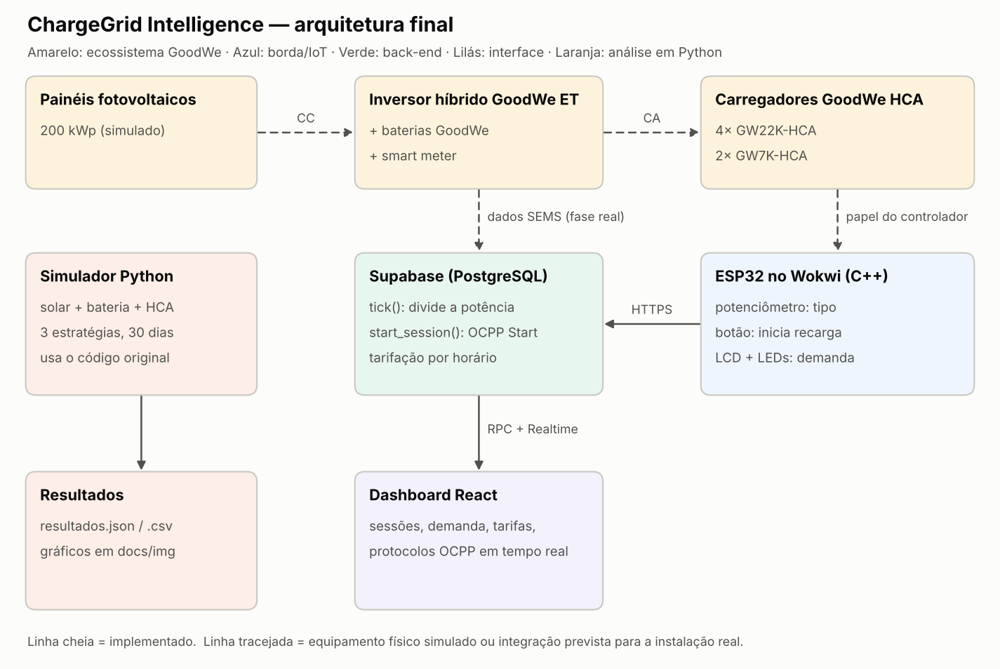
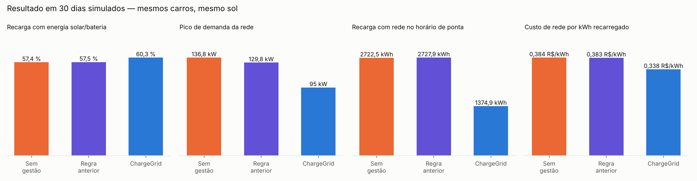
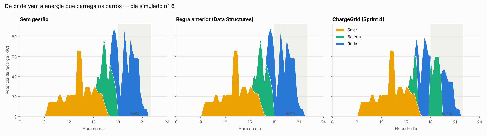
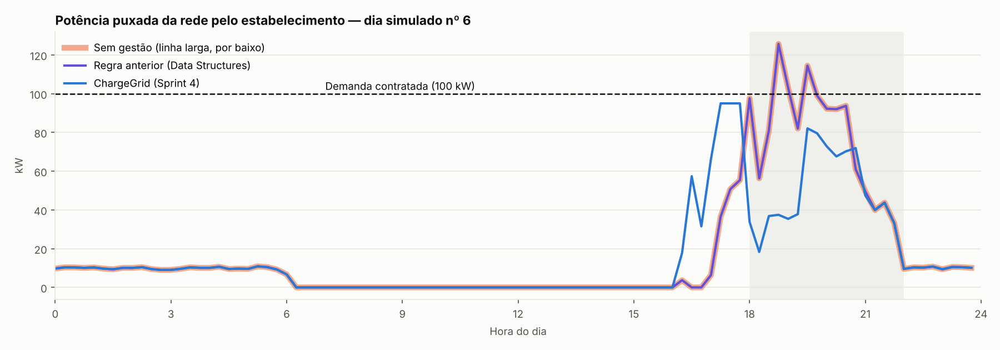

# ⚡ ChargeGrid Intelligence — Gestão inteligente de recarga de veículos elétricos com energia solar

> Challenge GoodWe · FIAP · Ciência da Computação · Turma 1CCPO · Sprint 4 — Solução Final Integrada

ChargeGrid é um sistema de gestão de recarga de veículos elétricos (VE) para **estabelecimentos comerciais** (supermercados, shoppings, estacionamentos). A cada ciclo, ele decide quanta potência cada carregador GoodWe HCA recebe e de qual fonte ela vem (sol, bateria ou rede), sem ultrapassar a demanda contratada com a distribuidora. Em seguida, calcula a tarifa de cada recarga.

---

## 📌 Sumário
1. [Equipe](#1-equipe)
2. [O problema](#2-o-problema)
3. [Arquitetura final e integração](#3-arquitetura-final-e-integração)
4. [Evolução do algoritmo](#4-evolução-do-algoritmo)
5. [Depuração do código anterior](#5-depuração-do-código-anterior)
6. [Alinhamento com o desafio GoodWe](#6-alinhamento-com-o-desafio-goodwe)
7. [Resultados](#7-resultados)
8. [Avaliação crítica: sustentabilidade e inovação](#8-avaliação-crítica-sustentabilidade-e-inovação)
9. [Alinhamento com as disciplinas](#9-alinhamento-com-as-disciplinas)
10. [Tecnologias, ferramentas e sensores](#10-tecnologias-ferramentas-e-sensores)
11. [Estrutura do repositório e como executar](#11-estrutura-do-repositório-e-como-executar)
12. [Vídeos](#12-vídeos)
13. [Referências](#13-referências)

---

## 1. Equipe

| Nome | RM | Papel |
|---|---|---|
| Lucas Klein da Veiga | RM570029 | Programação front-end (dashboard React) |
| Gustavo Melo dos Santos | RM573562 | Programação back-end |
| João Victor Canello Ferian | RM573295 | Programação back-end |
| João Pedro Costenari Silva | RM572260 | Depuração geral (Python, C++ e integração) |

---

## 2. O problema

Um estacionamento comercial com carregadores de VE enfrenta três problemas:

1. **Estouro da demanda contratada.** Os clientes chegam juntos no fim da tarde. Se cada carro puxa a potência máxima, a soma com o consumo da loja ultrapassa o limite contratado e gera multa de ultrapassagem.
2. **Recarga no horário mais caro.** O pico de chegadas (17h–20h) coincide com o horário de ponta.
3. **Energia solar mal aproveitada.** Os painéis geram de dia, mas grande parte da recarga acontece depois das 17h. Sem bateria e sem coordenação, o sol não chega aos carros.

**Proposta:** um sistema que conhece a geração solar, a carga da bateria, o consumo da loja e os carros conectados, e **decide automaticamente** a potência de cada carregador.

---

## 3. Arquitetura final e integração



### 3.1 Camadas

| Camada | Tecnologia | O que faz | Pasta |
|---|---|---|---|
| Geração e armazenamento | Inversor híbrido GoodWe (série ET) + baterias GoodWe | Converte o sol, guarda o excedente e devolve na ponta | (simulado em `analise/`) |
| Recarga | Carregadores GoodWe HCA (GW22K-HCA e GW7K-HCA) | Executam a recarga com potência ajustável | (simulado) |
| Borda / IoT | ESP32 no Wokwi (C++) | Totem do carregador: escolhe o tipo, inicia a recarga e mostra a demanda em LCD e LEDs | `firmware/` |
| Back-end | Supabase (PostgreSQL + funções SQL) | `start_session()` (OCPP StartTransaction), `tick()` (redistribui potência e encerra recargas), tarifação | `supabase/` |
| Interface | React + TypeScript + Vite + Recharts | Sessões, demanda, tarifas e log OCPP em tempo real | raiz (`pages/`, `components/`) |
| Lógica original | Python — sprint anterior (Data Structures) | Simulador de terminal: sessões, redistribuição, tarifação, OCPP e relatório | `backend_python/` |
| Análise | Python | Simula 30 dias com sol, bateria, loja e carros; compara 3 estratégias | `analise/` |

### 3.2 Fluxo integrado (ponta a ponta)

1. O cliente inicia a recarga pelo **dashboard** (tela *Nova sessão*) ou pelo **totem ESP32** (potenciômetro escolhe o tipo, botão inicia).
2. O pedido chega a `start_session()` no Supabase, que valida os dados, registra o carro e grava o evento OCPP `StartTransaction`. O totem usa a mesma função, via **HTTPS**.
3. O **dashboard** mostra a sessão nova em ~2 s, e a página **Protocolos** recebe o evento por *Realtime* (WebSocket).
4. A cada ciclo, `tick()` atualiza a bateria de cada carro, **redistribui a potência** se a soma passar de 100 kW e encerra as recargas completas com `StopTransaction` e o custo final. Tanto o ESP32 (a cada 5 s) quanto o dashboard (a cada 2 s) disparam o ciclo.
5. O totem ESP32 lê `get_demanda()` e acende o **LED vermelho** quando a demanda chega a 95% do limite.

> O firmware do totem está em `firmware/`, mas não é usado na demonstração em vídeo; ali a recarga é iniciada pelo dashboard e a análise roda no terminal.
6. O **simulador Python** reproduz a lógica com **solar e bateria** ao longo de 30 dias e mede o ganho (seção 7).

### 3.3 Segurança

Todas as tabelas têm *Row Level Security*: leitura pública e **nenhuma escrita direta**. Toda escrita passa por `start_session()` e `tick()`, que aplicam as regras de negócio (tipo válido, máximo de 10 carros simultâneos). A chave usada pelo ESP32 e pelo front é a *anon key*, pública por design.

---

## 4. Evolução do algoritmo

### 4.1 Regra anterior (sprint Data Structures — `backend_python/gerenciamentoDeRecarga.py`)
Se a soma das potências **dos carregadores** chega a 100 kW, o carro com menos bateria recebe prioridade e os outros dividem o resto. Essa é a regra que hoje roda no Supabase (`tick()`).

**Limitação:** a regra só enxerga os carregadores. Ela não sabe que a loja também consome energia, que há sol ou que existe uma bateria.

### 4.2 ChargeGrid (Sprint 4 — `analise/simulador_chargegrid.py` → `estrategia_chargegrid()`)

**Entradas a cada 15 min:** geração solar, consumo da loja, carga da bateria, horário (tarifa) e carros conectados (tipo, energia que falta, horário de saída).

**Regras, em ordem:**
1. **Segurança da rede:** a importação **total** (loja + carros) nunca passa de 95% da demanda contratada.
2. **Garantia de entrega:** cada carro recebe primeiro a **potência mínima** para terminar antes de sair (`energia que falta ÷ tempo que falta`).
3. **Energia limpa primeiro:** o excedente solar vai para os carros. A bateria fica **reservada para a ponta** e só ajuda fora dela acima de 80% de carga.
4. **Rede só fora da ponta:** das 18h às 21h, a rede cobre apenas o mínimo da regra 2.
5. **Ordem de atendimento:** prioridade > rápida > lenta. Em empate, vai antes o carro com menos folga de tempo.

```
para cada intervalo de 15 min:
    limpa = max(0, solar - consumo_loja) + bateria_disponível
    rede  = 95% da demanda contratada - consumo_loja não coberto pelo sol
    ordenar carros por (tipo, folga de tempo)
    1º: cada carro recebe a potência mínima para terminar a tempo
    2º: distribuir a energia limpa que sobra até a potência máxima de cada um
    3º: fora da ponta, completar com rede até o limite
    sobra de sol → carrega a bateria;   bateria → cobre a ponta
```

**Complexidade:** O(n log n) por ciclo (ordenação de n carros).

---

## 5. Depuração do código anterior

Ao reaproveitar o código da sprint anterior, a depuração encontrou três defeitos em `gerenciamentoDeRecarga.py`. Todos são reproduzíveis com `python analise/teste_regra_anterior.py`, que também mostra a versão corrigida. O código original foi mantido sem alteração em `backend_python/`.

| # | Defeito | Causa | Efeito | Correção |
|---|---|---|---|---|
| 1 | Carro prioritário recebe **mais que o máximo** | `potenciaMaxima * 1.4` | Um carro de 22 kW "recebe" 30,8 kW, fisicamente impossível num HCA | `min(potenciaMaxima, demandaContratada)` |
| 2 | **IDs repetidos** | `id = len(carrosAtivos) + 1` | Depois que um carro sai, o próximo pode receber o mesmo ID de um carro ativo, quebrando o `transactionId` do OCPP | Contador que só aumenta |
| 3 | Potência cortada **nunca volta** | `gerenciarCarregamento()` só age acima do limite | Quando carros saem, os restantes continuam limitados (no teste: 34,6 de 100 kW usados com 2 carros) | Voltar todos ao máximo antes de redistribuir |

Também identificamos uma inconsistência de especificação: o tipo "prioridade" usava **50 kW**, mas o GoodWe HCA é um carregador AC de no máximo **22 kW**.

**No sistema em produção (Supabase):** o defeito 2 não ocorre, porque o ID é gerado pelo banco. Os defeitos 1 e 3 tinham sido portados para o `tick()` e foram **corrigidos na migration `0003_sprint4_correcoes.sql`**, que também limita "prioridade" a 22 kW. A diferença da prioridade passa a ser a ordem de atendimento e o adicional de tarifa. Testamos a correção num PostgreSQL local, com o mesmo cenário antes e depois:

| Cenário | Antes (0001 + 0002) | Depois (0003) |
|---|---|---|
| 5 carros (2 prioridade, 3 rápida) | um carro de 22 kW recebe **30,8 kW** | nenhum carro acima do máximo |
| 3 saem, ficam 2 | os 2 presos em **17,3 kW** (34,6 de 100 kW usados) | os 2 voltam a **22 kW** |

---

## 6. Alinhamento com o desafio GoodWe

| Requisito | Como o ChargeGrid atende | Tecnologia GoodWe |
|---|---|---|
| Geração renovável | Excedente solar é a primeira fonte da recarga | Inversor híbrido série ET (trifásico, comercial) |
| Armazenamento | Bateria guarda o sol do meio-dia para a ponta das 18h–21h | Baterias GoodWe acopladas ao inversor híbrido |
| Uso inteligente | Potência de cada carregador decidida a cada ciclo, com limite de demanda | Carregador HCA: potência ajustável e gestão via SEMS |
| Monitoramento | Dashboard + totem ESP32 com demanda em tempo real | Na instalação real, os dados viriam do SEMS Portal |
| Integração | Dashboard → Supabase (OCPP, tarifação, demanda) e simulador Python com a regra original da equipe | Smart meter / comunicação nativa do inversor |

**Por que cada escolha:**
- **GW22K-HCA (×4) e GW7K-HCA (×2):** o HCA foi feito para operar com inversores e baterias GoodWe e carregar o carro com o excedente solar, gerenciado pelo SEMS. A versão de 22 kW atende quem fica pouco tempo; a de 7 kW, quem fica a tarde toda.
- **Inversor híbrido ET:** é a linha trifásica com bateria, adequada a um consumidor comercial. Sem bateria, o sol só atende quem carrega antes das 17h.
- **SEMS Portal:** é a plataforma oficial de monitoramento da GoodWe. O ChargeGrid não a substitui; ele é a **camada de decisão** que usaria os dados dela.

> **Transparência:** nenhum equipamento GoodWe físico foi usado. O totem do carregador foi escrito para ESP32 simulado no Wokwi, e o sistema solar/bateria é simulado em Python com as características dos equipamentos.

---

## 7. Resultados

### 7.1 Cenário simulado (premissas)

| Parâmetro | Valor |
|---|---|
| Estabelecimento | Supermercado, aberto das 8h às 22h, consumo de 35–45 kW |
| Geração solar | 200 kWp no telhado, nebulosidade sorteada por dia |
| Bateria | 150 kWh úteis, 60 kW, nunca abaixo de 20% |
| Carregadores | 4× GW22K-HCA + 2× GW7K-HCA |
| Demanda contratada | 100 kW (mesmo limite do código original e do `tick()`) |
| Tarifas | Ponta (18h–21h) R$ 0,95 · intermediária R$ 0,80 · madrugada R$ 0,65 — as mesmas de `sistemaCobranca.py` |
| Carros | 532 em 30 dias (~18/dia, Poisson); 60% de dia e 40% entre 17h e 20h; 8–30 kWh; permanência de 1,5–4 h |
| Período | 30 dias, passos de 15 min, semente 42 (reproduzível) |

As três estratégias recebem **exatamente os mesmos carros, o mesmo sol e o mesmo consumo**. Só muda a decisão. A "regra anterior" roda o **código original da equipe**, importado de `backend_python/`.

### 7.2 Resultados quantitativos (30 dias)

| Indicador | Sem gestão | Regra anterior | **ChargeGrid** |
|---|---|---|---|
| Ultrapassagens da demanda contratada (intervalos de 15 min) | 28 | 28 | **0** |
| Pico de demanda da rede | 136,8 kW | 129,8 kW | **95,0 kW** |
| Recarga com rede no horário de ponta | 2.722,5 kWh | 2.727,9 kWh | **1.374,9 kWh** |
| Custo de rede da recarga | R$ 3.554,24 | R$ 3.544,69 | **R$ 3.075,64** |
| Custo de rede por kWh recarregado | R$ 0,384 | R$ 0,383 | **R$ 0,338** |
| Recarga com energia solar ou bateria | 57,4% | 57,5% | **60,3%** |
| Energia pedida que foi entregue | 92,1% | 92,3% | 92,0% |
| Recargas completas | 79,1% | 79,3% | 78,8% |
| Carros que não encontraram carregador livre | 10 | 11 | **18** |
| CO₂ evitado na recarga | 131,4 kg | 131,4 kg | 135,6 kg |

**Por que a regra anterior quase não ajudou:** ela só age quando os *carregadores* somam 100 kW. Com 6 carregadores (máx. 102,8 kW), isso quase nunca acontece, e ela ignora os 35–45 kW da loja. A ultrapassagem acontece na soma loja + carros, que a regra não enxerga.

**Robustez:** com as sementes 1 a 5, o ChargeGrid zerou as ultrapassagens em todas, reduziu o pico em 18–29% e cortou de 46% a 53% da recarga com rede na ponta.







**Leitura do dia simulado nº 6:** sem gestão e com a regra anterior (as linhas coincidem), os carros que chegam às 18h–19h puxam tudo da rede e a demanda bate 126 kW. O ChargeGrid adianta a recarga para antes das 18h, usa a bateria guardada no começo da ponta e mantém a rede abaixo de 95 kW.

**Cálculo do CO₂:** `kWh de solar/bateria na recarga × 0,0247 tCO₂/MWh` (média mensal jan–abr/2025 do fator de emissão do SIN, MCTI/SIRENE).

### 7.3 Resultados qualitativos (sistema em funcionamento)

- Recarga iniciada pelo dashboard aparece na lista de sessões, com bateria e custo atualizados a cada ~2 s.
- Log OCPP 1.6 (`BootNotification`, `StartTransaction`, `StopTransaction`) em tempo real.
- Tarifa decomposta (horário + demanda + tipo de recarga) exibida antes de confirmar.
- Banco protegido contra escrita direta (RLS).

---

## 8. Avaliação crítica: sustentabilidade e inovação

### 8.1 Onde está o ganho real
- **Econômico e de rede (ganho principal):** zero ultrapassagens de demanda, pico 30% menor e metade da energia de ponta. Isso evita multa, adia aumento da demanda contratada e alivia a rede no horário mais crítico.
- **Ambiental (ganho pequeno, e explicamos por quê):** o CO₂ evitado é baixo porque a matriz elétrica brasileira já é muito limpa (~25 kg de CO₂ por MWh em 2025). O benefício maior está em **viabilizar a mobilidade elétrica** sem exigir mais infraestrutura de rede, e em tirar carga do horário de ponta, quando o operador costuma despachar termelétricas.
- **Social:** carregadores em locais comerciais ampliam a rede pública de recarga, uma das barreiras à adoção de VE no Brasil.

### 8.2 Diferenciais
- Decisão automática com **quatro restrições simultâneas** (sol, bateria, rede e demanda), incluindo o consumo da loja, que a regra anterior ignorava.
- **Garantia de entrega:** a gestão quase não piora a energia entregue (92,1% → 92,0%).
- **Bateria com estratégia:** reservada para a ponta, em vez de descarregar assim que pode.
- Firmware de um totem ESP32 que usa o mesmo caminho do dashboard (`start_session()` via HTTPS) e sinaliza a demanda em LCD e LEDs.
- Tarifação dinâmica e protocolo OCPP 1.6 simulado, o mesmo padrão dos carregadores comerciais.

### 8.3 Limitações
- **Menos carros atendidos:** com recargas mais lentas, os carregadores ficam ocupados por mais tempo, e 18 carros não encontraram vaga, contra 10 sem gestão. É o custo de não ultrapassar a demanda. Mais carregadores de 7 kW ou reserva de horário reduziriam esse efeito.
- **Firmware ESP32 não validado em execução:** o código passou por verificação de sintaxe, mas não foi executado no Wokwi nesta entrega.
- **Tudo é simulado.** Clima, comportamento dos clientes e consumo real mudam os números.
- **O algoritmo com sol e bateria roda no simulador Python.** O `tick()` do Supabase usa a regra anterior, já corrigida (seção 5), que só enxerga os carregadores.
- **Sobra de potência na divisão:** quando um carro lento não absorve a parte dele, a sobra não é repassada aos outros (ex.: 96,3 de 100 kW com 8 carros). O comportamento vem da regra original e foi mantido.
- **Velocidade da simulação no dashboard:** o `tick()` acelera a recarga em 100×, herdado de `equacoesRecarga.py`, para a demonstração caber em minutos.
- **Painel de fluxo de energia e insights de IA do dashboard** usam valores fixos (`mock/`). Não são calculados ao vivo.
- **Sem equipamento real:** a comunicação com o SEMS e o controle remoto do HCA não foram testados.
- **Custo:** o payback não foi calculado porque depende de preços de equipamento que não levantamos.

### 8.4 Próximos passos
1. Levar `estrategia_chargegrid()` para dentro do `tick()`, com repasse da sobra de potência.
2. Alimentar o painel de fluxo de energia com `resultados/serie_temporal.csv`.
3. Ler dados reais do SEMS Portal.
4. Usar previsão de geração solar para planejar a recarga do dia.

---

## 9. Alinhamento com as disciplinas

### 9.1 Pensamento Computacional e Automação com Python — Prof. Alexandre Russi Junior

| Conceito | Onde aparece | Arquivo |
|---|---|---|
| **Decomposição** | Sprint anterior: um arquivo por responsabilidade (carro, equações, gerenciamento, cobrança, OCPP, relatório). Sprint 4: dados → decisão → balanço → indicadores → gráficos | `backend_python/`, `analise/simulador_chargegrid.py` |
| **Reconhecimento de padrões** | Tarifa por faixa de horário; perfil solar em sino; pico de chegadas às 17h–20h | `sistemaCobranca.py`, `gerar_solar()`, `gerar_veiculos()` |
| **Abstração** | Classes `Carros`, `SistemaCobranca`, `SimuladorOCPP`; na Sprint 4, `Veiculo`, `Bateria`, `Cenario` | ambas as pastas |
| **Algoritmo** | Redistribuição por prioridade (anterior) → decisão com 5 regras (Sprint 4) | `redistribuirCarregamento()`, `estrategia_chargegrid()` |
| **Estruturas de dados** | Listas de carros ativos/finalizados, `min(..., key=lambda)`, dicionários de alocação, `sorted(key=...)` | ambas |
| **Reuso de código** | O simulador da Sprint 4 importa e executa a classe `GerenciamentoDeRecarga` original | `estrategia_equipe()` |
| **Funções como parâmetro** | A mesma `simular()` recebe a estratégia como argumento | `simular(nome, estrategia, ...)` |
| **Tratamento de erros e validação** | `validar_int()` / `validar_texto()` com `try/except`; validação de argumentos | `simuladorDeRecarga.py`, `main()` |
| **Depuração e testes** | Reprodução de 3 defeitos com saída determinística | `analise/teste_regra_anterior.py` |
| **Automação** | Loop de monitoramento que avança a recarga a cada segundo, com `threading.Lock` (anterior); 30 dias simulados gerando JSON, CSV, Markdown e 3 gráficos com um comando (Sprint 4) | `simuladorDeRecarga.py`, `main()` |
| **Arquivos** | Relatório `.txt` (anterior); `.json`, `.csv`, `.md`, `.png` (Sprint 4) | `GerarRelatorio.py`, `main()` |

### 9.2 Soluções em Energias Renováveis e Sustentáveis — Prof. André Tritiack de Farias

| Conceito | Onde aparece |
|---|---|
| **Geração fotovoltaica** | Curva de geração de 200 kWp com variação de nebulosidade |
| **Armazenamento** | Bateria com SOC mínimo, eficiência de carga/descarga e estratégia de uso na ponta |
| **Autoconsumo × injeção** | Indicador de autoconsumo solar (~80%) |
| **Gestão de demanda e ponta** | Limite de 100 kW, tarifa de ponta das 18h às 21h, deslocamento da recarga |
| **Eficiência energética** | Pico 30% menor e metade da energia de ponta |
| **Pegada de carbono** | Fator de emissão do SIN aplicado à energia renovável da recarga |
| **Mobilidade elétrica** | Integração FV + bateria + carregador ("sun-to-car") |
| **Viabilidade** | Análise crítica de ganhos, trade-offs e limitações (seção 8) |

---

## 10. Tecnologias, ferramentas e sensores

| Categoria | Item | Uso |
|---|---|---|
| Linguagens | Python 3, TypeScript, SQL (PL/pgSQL), C++ (Arduino) | Lógica e análise, front, back-end, firmware |
| Python | biblioteca padrão (`threading`, `uuid`, `json`, `dataclasses`, `argparse`, `csv`) + matplotlib | Simuladores e gráficos |
| Front-end | React 18, Vite, React Router, Tailwind CSS, Recharts, lucide-react | Dashboard |
| Back-end | Supabase (PostgreSQL, RPC, Realtime, Row Level Security) | Estado e regras de negócio |
| Microcontrolador | ESP32 DevKit C v4 (simulado no Wokwi) | Totem do carregador |
| Componentes | Potenciômetro, botão, LCD 16x2 I2C, 3 LEDs | Entrada do cliente e sinalização de demanda |
| Bibliotecas do firmware | WiFi, HTTPClient, WiFiClientSecure, ArduinoJson, LiquidCrystal I2C | Comunicação HTTPS com o Supabase e exibição |
| Protocolo | OCPP 1.6 (mensagens simuladas) | Comunicação carregador ↔ central |
| Equipamentos de referência | GoodWe GW22K-HCA, GW7K-HCA, inversor híbrido série ET, baterias GoodWe, SEMS Portal | Arquitetura-alvo |
| Ferramentas | Git/GitHub, VS Code, Wokwi, Vercel | Versionamento, desenvolvimento, simulação, publicação |

---

## 11. Estrutura do repositório e como executar

```
/
├── README.md
├── backend_python/               # código Python da sprint anterior (original, sem alteração)
├── analise/
│   ├── simulador_chargegrid.py   # 30 dias: sem gestão × regra anterior × ChargeGrid
│   ├── teste_regra_anterior.py   # reproduz os 3 defeitos e a correção
│   └── diagrama_arquitetura.py   # gera docs/img/arquitetura.png
├── firmware/wokwi_carregador_hca/  # sketch.ino, diagram.json, libraries.txt (ESP32)
├── supabase/                     # migrations SQL (back-end)
├── resultados/                   # resultados.json, resultados.md, serie_temporal.csv
├── docs/img/                     # diagrama e gráficos
├── pages/ components/ lib/ ...   # front-end React
└── requirements.txt
```

**Simulador da sprint anterior (terminal):**
```bash
cd backend_python && python simuladorDeRecarga.py
```

**Análise da Sprint 4 (Python 3.10+):**
```bash
pip install -r requirements.txt
python analise/simulador_chargegrid.py              # 30 dias, semente 42
python analise/simulador_chargegrid.py --dias 7 --semente 3
python analise/teste_regra_anterior.py              # depuração
```

**Back-end:** rodar no SQL Editor do Supabase, em ordem, `0001_chargegrid_schema.sql`, `0002_start_session_capacity_input.sql` e `0003_sprint4_correcoes.sql`, da pasta `supabase/migrations/` (detalhes em `supabase/README.md`).

**Front-end:**
```bash
cp .env.example .env    # preencher VITE_SUPABASE_URL e VITE_SUPABASE_ANON_KEY
npm install
npm run dev
```

**Firmware:** como montar no Wokwi em `firmware/README.md`.

---

## 12. Vídeos

Os dois vídeos (um por disciplina, YouTube não listado) estão linkados no arquivo `.txt` entregue em cada disciplina.

---

## 13. Referências

- GoodWe — *HCA Series EV Charger*, página e datasheet: https://en.goodwe.com/au/hca-evcharger
- GoodWe — inversores híbridos série ET e baterias; SEMS Portal (monitoramento).
- MCTI / SIRENE — fatores de emissão de CO₂ do Sistema Interligado Nacional (médias mensais de 2025).
- Open Charge Alliance — OCPP 1.6.
- Repositório da sprint anterior: https://github.com/joaovictorferian/Equipe02-1CCPO
- Documentação: Supabase, React, Vite, Recharts, matplotlib, Wokwi, ESP32 Arduino Core, ArduinoJson.
